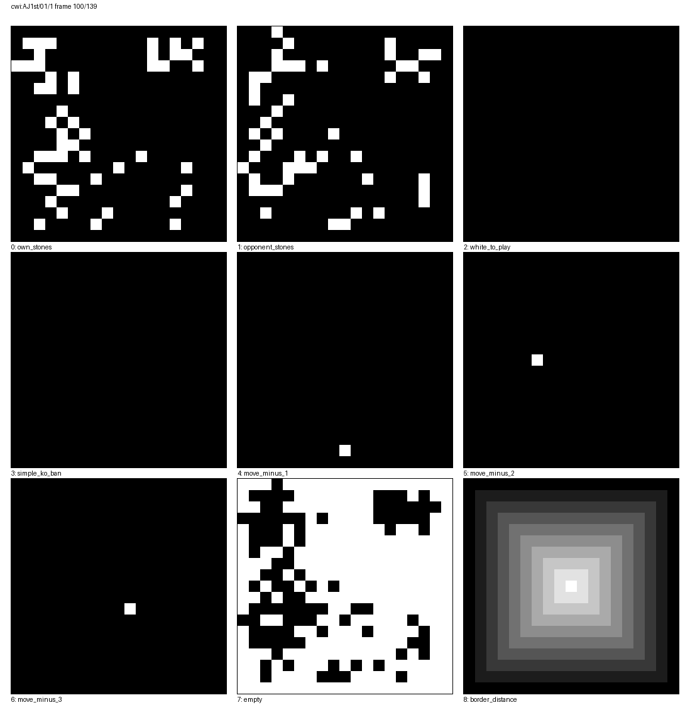

# M2 / M3 数据与特征验收

> 日期：2026-10-24
> 结论：**M2、M3 通过**。实际导入 10,000 局 19×19 棋谱，全部经 KataGo 重放；
> 特征张量与可视化自检均完成。

## 1. 数据源

| 项目 | 值 |
|---|---|
| 来源 | [CWI Database of Go Games](https://homepages.cwi.nl/~aeb/go/games/) |
| 归档 | `games.tgz` |
| 归档 SHA-256 | `c57ad2ba3c5f3a3ee145bb77bcc9c0167c0d7b5478cf691a8939f750511071e2` |
| 许可声明 | CWI 页面声明这些棋谱属于 public domain |
| 归档大小 | 44.52 MiB |
| 本地生成 | `data/cwi-10k.nngames`（被 `.gitignore` 排除） |
| 数据集 SHA-256 | `bc4ea0c7929350395a0d632f53b2a59f270b6bb7510b3dcd5095c670e49d2313` |

归档内共有 96,969 个 SGF。稳定按路径排序并只收 19×19，扫描 10,066 个文件后
得到前 10,000 个可用对局。

## 2. M2 结果

| 指标 | 结果 |
|---|---:|
| 对局 | **10,000** |
| 文件大小 | 24,591,541 bytes |
| 走法 | **2,076,112** |
| 可训练局面（含初始局面） | **2,086,112** |
| 初始布置子 | 293 |
| 全量重放被提子 | 135,166 |
| 全量重放 | **10,000/10,000 成功** |
| KVRecord v2 往返 | **逐字节一致** |

扫描时排除：

- 17 个 9×9、4 个 13×13：符合 D2，不进入正式 19×19 训练集；
- 43 个 SGF 没有主线走法；
- 2 个 SGF 属性存在多值，sgfmill 明确拒绝。

`go_data_cli verify` 无采样参数时重放全部 10,000 局，CPU 用时约 **4.84 s**，
峰值 RSS 约 **195 MiB**。随机 1,000 局种子 `20261024` 的子集检查同时通过。
数据容器时间戳固定为 `2026-10-24T00:00:00Z`，相同归档重新导入时应得到同一 SHA。

## 3. M3 结果

Token：

- 19×19 点位 ID `0..360`
- PASS `361`
- BOS/EOS/DECISION/PAD/UNK `362..366`
- `.nnvocab` 类型 `go`，词表大小 **367**
- 文件：`data/go.nnvocab`（被 `.gitignore` 排除）

特征：

- 9 个 `float32` 平面：己方、对方、白方行棋、简单劫、最近三手、空点、边界距离
- 单局面 `(9,19,19)`
- neuralnet.cpp 列布局 `(9×19×19, 1) = (3249, 1)`
- 5 个 scalar：贴目、手数、双方被提子数、净提子

真实样本：`cwi:AJ1st/01/1` 第 100/139 手。

| 产物 | 位置 |
|---|---|
| 特征张量 | [`m3-feature-planes.npy`](m3-feature-planes.npy) |
| 平面可视化 | [`m3-feature-planes.png`](m3-feature-planes.png) |
| 格式说明 | [`08-data-and-features.md`](../design/08-data-and-features.md) |



## 4. 验收命令

```bash
python3 -m venv .venv
.venv/bin/python -m pip install -e .

cmake --preset cpu
cmake --build --preset cpu
ctest --preset cpu --output-on-failure

.venv/bin/go-pipeline download
.venv/bin/go-pipeline ingest --limit 10000
.venv/bin/go-pipeline verify --sample 1000
.venv/bin/go-pipeline tokenizer
.venv/bin/go-pipeline features --index 0 --frame 100
```

本机 CTest **5/5**。新增 `go_pipeline_m2_m3_tests` 覆盖 SGF、KVRecord 打包/统计/
导出/重放、token round-trip、`.nnvocab`、任意局面特征、trace 与 PNG 输出。

## 5. 解释边界

- 这是可复现的数据管线验收，不是训练质量验收；策略/价值 loss 在 M4 验证。
- 历史棋谱按 KataGo tolerant replay 读取，以保留来源记录；严格合法性由 M1 题库和
  后续训练期校验覆盖。
- 特征 v1 只有 9 平面；超级劫历史、真实气、征子状态等留给后续消融，不阻塞 M4。
- 数据文件在本地生成，不提交进 Git；归档 SHA、数据集 SHA 与格式版本已固定。
